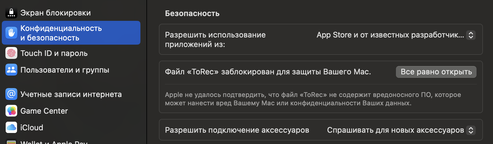

# ToRec

ToRec is a lightweight native app by T-Orbit for local audio recording of calls without OBS.

The stable MVP is the native macOS client. An experimental Windows beta now lives under `apps/windows` for student-side testing.

The MVP is a local-first recorder for Vlad, a QA/AQA mentor, who needs reliable recordings of student calls, lead sales calls, interview debriefs, and important or sensitive conversations.

## macOS MVP

- macOS only.
- Target machine: MacBook M4 Pro.
- Target OS: macOS Sequoia.
- Audio-only recording.
- Automatic recording start.
- Auto-start v2 rule engine using active app, microphone activity, browser call-title heuristics, allowlist/blocklist, cooldown, and minimum detection duration.
- Microphone recording.
- Deterministic microphone input selection that blocks AirPods/Bluetooth headset mics for recording and uses only external, built-in, or other non-Bluetooth inputs.
- Full system audio recording.
- Local file storage.
- Local settings stored on the Mac.
- Settings screen for preferred microphone, required MVP output indicators, auto-start rules, storage root, screenshot hotkeys, disabled custom-hotkey placeholders, and local privacy controls.
- `metadata.json` stored next to every recording.
- Manual Library tagging after recording stops.
- MVP tags saved to `metadata.json` and `db/app.sqlite`.
- Tag dialog supports quick tags, custom tags, and status selection without permanent tag controls on the main screen.
- Local recordings list with filters by date, status, source app, title, and tag.
- No Electron.
- No screen recording, cloud upload, T-Orbit sync, cloud AI, or automatic AI in the macOS MVP. Records also has an explicit local-only transcription add-on after optional Parakeet setup in Settings.

## Windows Beta

Windows support is an experimental v0.2 beta, not feature-parity with macOS yet.

Implemented:

- native Windows tray app;
- automatic call recording start for likely Zoom/Meet/KTalk/Teams/Telegram/Discord calls;
- automatic stop for auto-started recordings after call-like audio disappears;
- manual Start/Stop recording as a fallback;
- microphone recording;
- system-audio recording through WASAPI loopback;
- local records list;
- local diagnostics and logs.

Not implemented yet:

- installer/MSIX;
- cloud upload;
- T-Orbit sync;
- AI transcription.

Windows source:

```text
apps/windows/
```

Windows artifact is built on GitHub Actions by `.github/workflows/windows-build.yml` because the current development machine is macOS and does not have local Windows audio APIs.

Windows auto-start watches Windows audio sessions once per second. Known call apps such as Zoom, Teams, Telegram, Discord, Slack, Webex, Skype, and KTalk can start after 10 seconds of stable audio-session activity. Browser processes such as Chrome, Edge, Firefox, Brave, Opera, Yandex, and Arc require a call-like window title containing hints such as Meet, Zoom, Teams, KTalk, call, interview, or Russian call/interview words. Auto-started recordings auto-stop after 10 seconds without a call-like audio session. Manual recordings do not auto-stop.

## Default Storage

```text
~/Recordings/TOrbitRecorder/
  Inbox/
    Unsorted/
    Short/
    Failed/
  Library/
    YYYY/
      MM/
        YYYY-MM-DD_HH-mm_source_audio/
          source/
            mic.m4a
            system.m4a
          export/
            mixed.m4a
          metadata.json
  db/
    app.sqlite
  logs/
```

`db/app.sqlite` stores the local recordings index for list filtering and quick library actions. The recording folder and `metadata.json` remain the canonical record.

The storage folder intentionally keeps the historical `TOrbitRecorder` name so existing local recordings keep working after the user-facing rename to ToRec.

Records refreshes that index from disk before listing: metadata folders under `Library/` and `Inbox/` are added back to the app, and rows whose session folder or `metadata.json` was deleted manually are removed from the app list.

For daily use, use the app `Records` window or the `Library` Finder action. Internal folders under `Inbox/` are workflow buckets:

- `Inbox/Unsorted/`: in-progress staging and crash-recovery candidates.
- `Inbox/Short/`: short recordings below the configured threshold.
- `Inbox/Failed/`: failed sessions kept for diagnostics.

The app should not make you browse these internal folders during normal testing.

## Repository Layout

```text
apps/macos/         Native macOS menu bar app
packages/core/      Testable recording engine and local domain logic
packages/protocol/  Shared storage and metadata contracts
docs/               Product and engineering documentation
samples/scripts/    Local helper scripts and experiments
tests/              Integration fixtures and test assets
```

## Documentation

- `docs/PRODUCT_SPEC.md`: product goal, user, scenarios, and success criteria.
- `docs/MVP_SCOPE.md`: exact MVP boundaries.
- `docs/ARCHITECTURE.md`: client architecture and future integration boundaries.
- `docs/RECORDING_ENGINE.md`: recorder lifecycle and capture rules.
- `docs/AUTOSTART_RULES.md`: automatic start policy.
- `docs/STORAGE_FORMAT.md`: folder layout and metadata schema.
- `docs/SECURITY_PRIVACY.md`: local-first privacy constraints.
- `docs/UI_REDESIGN.md`: MVP UI structure and redesign notes.
- `docs/QA_CHECKLIST.md`: focused manual QA checklist for install, permissions, recording, UI, auto-start, and edge cases.
- `docs/BUG_REPORT_TEMPLATE.md`: copy/paste bug report format for fast handoff back to Codex.
- `docs/DEVELOPMENT_WORKFLOW.md`: branch, PR, validation, and release workflow for post-MVP development.
- `docs/ROADMAP.md`: staged future work.
- `docs/QA_CHECKLIST.md`: manual macOS MVP validation checklist and troubleshooting.

## Development Rules

- Prefer native macOS APIs: Swift, SwiftUI, AVFoundation, ScreenCaptureKit.
- Keep the recording engine testable separately from UI.
- Do not fake working audio capture.
- Add logs for recorder lifecycle events and failures.
- Update docs for every behavior change.
- Validate with `swift test` and `xcodebuild` when the relevant project files exist.

## Build

```sh
./scripts/build_macos.sh
```

The current shell is a SwiftPM-based macOS app target. The build script compiles it and assembles a local app bundle at `apps/macos/.build/app/ToRec.app`. This `.build/app` bundle is a development artifact, not the normal launch location.

The build script injects app metadata into the bundle:

- app version: `v0.1.4-dmg-icon-fix`
- build date
- git commit hash

## Package

Create a shareable local package in `dist/`:

```sh
./scripts/package_macos.sh
```

This creates:

```text
dist/ToRec.app
dist/ToRec-v0.1.4-macOS.zip
dist/ToRec-v0.1.4-macOS.dmg
```

The zip is app-only and contains just `ToRec.app`. The DMG contains `ToRec.app`, an `Applications` shortcut, a visual arrow from the app to Applications, `Install ToRec.command`, and an `Open Privacy Settings` shortcut so non-technical testers have the install and Gatekeeper recovery steps in one place.

The current package is an internal ad-hoc signed build. It is suitable for controlled testing on trusted Macs, but it is not a public notarized macOS release yet. For a frictionless external install, add Developer ID signing and Apple notarization.

### Gatekeeper on Test Builds

macOS can block the first launch with a message that Apple cannot verify `ToRec`. This cannot be silently bypassed for testers while the app is ad-hoc signed and not notarized. The proper product fix is Apple Developer ID signing plus notarization.

The best free testing path is the DMG installer helper. It is not notarization and it does not disable Gatekeeper globally. It copies the app into `/Applications`, clears the downloaded-app quarantine attribute from that local copy, opens the installed app, and leaves a visible Privacy & Security fallback in the same DMG.

For trusted internal testing:

1. Open `ToRec-v0.1.4-macOS.dmg`.
2. Double-click `Install ToRec.command`.
3. If macOS asks whether Terminal may run it, allow it.
4. If macOS still blocks `ToRec`, click `Done`.
5. Double-click `Open Privacy Settings` in the DMG or open System Settings -> Privacy & Security -> Security manually.
6. Click `Open Anyway` / `Все равно открыть`.

Manual fallback:

1. Drag `ToRec.app` into `Applications`.
2. Open Finder -> Applications.
3. Right-click `ToRec` -> Open.
4. If macOS still blocks it, use `Open Privacy Settings` from the DMG and click `Open Anyway` / `Все равно открыть`.



Do not ask testers to disable Gatekeeper globally. The terminal workaround `xattr -dr com.apple.quarantine /Applications/ToRec.app` exists, but the recommended student install path is the DMG helper.

## Install

Install the packaged app into `/Applications` and open it:

```sh
./scripts/install_macos.sh
```

The installer packages the app, asks a running ToRec (`TOrbitRecorder` executable) process to quit before replacement, copies the app bundle to `/Applications/ToRec.app`, clears quarantine attributes for this local install path, opens it, and prints next steps.

Dry-run the installer without copying or opening the app:

```sh
DRY_RUN=1 ./scripts/install_macos.sh
```

## Run

Use the installed app for normal manual testing:

```sh
open /Applications/ToRec.app
```

Use `dist/` for shareable local artifacts and `/Applications/ToRec.app` for a normal macOS launch. Do not use `apps/macos/.build/app/ToRec.app` except when debugging the build script output directly.

Current recording implementation starts from the menu bar UI or Auto-start Engine v2 and writes the required MVP outputs: `source/mic.m4a`, `source/system.m4a`, and a quick-listen `export/mixed.m4a` preview. System audio and mixed export are always on in the MVP so each normal recording keeps the required artifact contract. When Volume leveling is enabled, it also creates `export/mixed_balanced.m4a` plus `analysis/audio_analysis.json`, and stores `audio.health` warnings in `metadata.json`. System audio uses a Core Audio process tap; no screen video is written. The main window is a compact recorder surface with one primary Start/Stop action plus a post-stop summary for the last completed recording; Library and Diagnostics open as separate windows. Marker metadata still exists, but marker controls are hidden from the default recorder UI until the workflow is clearer.

Older recordings can be reprocessed for balanced audio from `Library -> More -> Reprocess Audio`. Batch reprocessing for recordings missing `export/mixed_balanced.m4a` is available in `Diagnostics -> Audio Processing`.

Records can hand off a local audio file through macOS native sharing from `More -> Share Audio...` or the details-panel `Share` button. Sharing uses the best available local file in this order: `export/mixed_balanced.m4a`, `export/mixed.m4a`, `source/mic.m4a`, then `source/system.m4a`. `Copy Audio Path` copies that same preferred file path for manual upload or drag-and-drop workflows. This is a local OS handoff only; the MVP still has no Telegram bot/API integration and no cloud upload.

Records can also create non-destructive local clips from `Trim Audio...`. A clip is exported as `export/clip_*.m4a` in the same recording folder and can be shared immediately through the same macOS share sheet. The original source and mixed files are not modified.

Screenshots are manual still images, not screen recordings. `Full Screenshot` on the main window, `Capture Full Screenshot` in Records, `Cmd+Shift+S` while ToRec is active, or global `Ctrl+Option+S` immediately captures the full screen and saves a PNG under `screenshots/` inside the active recording folder, or the latest recording folder if no recording is active. There is no area/window selector in the MVP screenshot flow.

Local transcription is an optional add-on. The base recorder stays fast: it does not bundle transcription models and `Records -> Transcribe Locally` does not perform a first-run model download. Open `Settings -> Local transcription`, install the optional tools if needed, and run `Prepare Parakeet Model` once. After the setup status is `Ready`, Records can write `transcript/transcript.*` plus `transcript/call_note.md` inside the selected recording folder. The note includes metadata, full transcript, and a Codex review prompt. Nothing is uploaded by the app.

Local transcription prerequisites:

```sh
brew install uv ffmpeg
uv tool install parakeet-mlx -U
```

Settings currently cover preferred microphone selection, required MVP output indicators, optional local transcription setup, auto-start rules, storage actions, hotkeys, Dock/menu-bar behavior, and local privacy controls. Unimplemented controls are disabled in the UI.

Active settings are persisted locally with `UserDefaults`. MVP defaults keep microphone selection on `Auto, recommended`, Standard audio quality, required system audio and mixed export enabled, auto-start enabled, Launch at Login enabled, the Dock icon hidden, a 3 minute cooldown, 20 second detection duration, and a 60 second short-recording threshold. ToRec is menu-bar-first by default; use the menu bar icon or global `Ctrl+Option+R` to show the app window when the Dock icon is hidden. Custom hotkey capture, local-only mode, and Focus Mode reminder are visible as disabled placeholders until their runtime behavior exists.

Settings/About and Diagnostics/App include the app version, build date, git commit hash, and local storage path.

## Launch At Login

Automatic launch is enabled by default. You can review or disable it in:

```text
Settings -> Behavior -> Launch at Login
```

The app first uses the modern macOS `SMAppService.mainApp` login item API. If a development/ad-hoc bundle reports that the main login item service is unavailable, the app falls back to a local user LaunchAgent and Diagnostics labels that state explicitly. The intended test path is still the installed app bundle:

```sh
./scripts/install_macos.sh
open /Applications/ToRec.app
```

If macOS reports that approval is required, open System Settings -> General -> Login Items and enable ToRec. Diagnostics shows the current login item status, the running bundle path, and the last Launch at Login error if registration fails. For development builds, avoid switching between `.build/app`, `dist/`, and `/Applications` while testing Launch at Login because macOS tracks login items by app bundle identity and path.

## Auto-Start And Auto-Stop

Auto-started Zoom recordings are not tied to Zoom being the foreground window. You can switch to browser, notes, IDE, or slides during a call and the app keeps the recording active.

For Zoom, auto-start and auto-stop now prefer Core Audio process activity from `us.zoom.xos`: if the Zoom process is using input or output audio, the app treats the call as active even while Zoom is in the background. A visible meeting/conference window also keeps recording active. If Zoom process audio is idle and only the home/workplace window remains, the stop timer starts. The default auto-stop grace period is 10 seconds, and auto-start monitoring polls once per second so the stop happens close to that 10 second target. If macOS does not expose process audio or window titles, the fallback ignores microphone activity from ToRec itself and keeps recording only while global system audio is still active. Manual recordings do not auto-stop; they only stop from the Stop button, menu item, or app-active shortcut.

## Uninstall

Quit the app and remove the installed bundle:

```sh
osascript -e 'tell application id "com.torbit.recorder" to quit' || true
rm -rf /Applications/ToRec.app
rm -rf /Applications/TOrbitRecorder.app
```

This keeps local recordings. To delete all MVP recording data too:

```sh
rm -rf ~/Recordings/TOrbitRecorder
```

## Troubleshooting

Permissions are tied to the app bundle and code-signing identity that macOS sees. Dev packages are ad-hoc signed with the stable identifier `com.torbit.recorder`; install and run the same bundle every time:

```sh
./scripts/install_macos.sh
open /Applications/ToRec.app
```

Do not keep multiple copies running from `.build`, `dist`, and `/Applications`. macOS permissions are applied to the app bundle, current process, and code-signing requirement, so a second copy or freshly rebuilt ad-hoc binary can trigger a macOS permission prompt even when another `ToRec` entry is already enabled.

Check for duplicate running copies:

```sh
pgrep -fl TOrbitRecorder
```

System audio is captured with a Core Audio process tap. It should not require screen video capture. If the app still reports missing system audio permission or shows the macOS prompt again, quit every ToRec copy and reopen only the installed app:

```sh
osascript -e 'tell application id "com.torbit.recorder" to quit' || true
open /Applications/ToRec.app
```

macOS often requires a process restart after this permission changes. Use the in-app `Restart App` button when it is shown; the app waits for the current process to exit and then reopens `/Applications/ToRec.app`.

If you approved an older unsigned/hash-signed dev build before this fix, toggle `ToRec` off and on again in the system-audio section once, then restart `/Applications/ToRec.app`.

On first launch, use `Fix Permissions` before recording. It requests microphone access and then verifies system audio through the same Core Audio process tap path used by the recorder. Apple's Core Audio tap permission prompt appears when an aggregate tap device starts recording, so `Fix Permissions` runs a short temporary capture probe to trigger that prompt during onboarding. On macOS Sequoia, this maps to the `Only System Audio Recording` permission when macOS shows it separately. The prompt appears before `Start Recording` is available and before any real recording folder is created. If macOS has already granted system-audio access for the current bundle, the app stores that successful capture-start verification for the current build and marks system audio as ready on relaunch. After the microphone prompt, the app brings the Recorder window back to the front before starting the system-audio probe, so the system-audio prompt appears over the yellow permissions panel. It does not refocus immediately after the system-audio request, which prevents the macOS prompt or Settings flow from being covered.

After the Core Audio capture-start probe succeeds, ToRec treats system-audio capture as ready for the current bundle. A real recorder permission failure clears the remembered state and sends the user back to onboarding. If an ad-hoc rebuild changes the code-signing hash, macOS can require approval again even when an older `ToRec` entry is still visible in System Settings.

Grant permissions in:

- System Settings -> Privacy & Security -> Microphone
- System Settings -> Privacy & Security -> Screen & System Audio Recording -> `ToRec`
- If macOS shows a separate `Only System Audio Recording` section, enable `ToRec` there too.

Recordings are stored locally in `~/Recordings/TOrbitRecorder/`.

If Launch at Login fails in a development build, install the app into `/Applications`, reopen that exact bundle, and toggle Launch at Login again. When the local LaunchAgent fallback is used, the plist is stored at `~/Library/LaunchAgents/com.torbit.recorder.login.plist`.

## Microphone Input Policy

`Auto, recommended` is resolved by the core `DevicePriorityResolver`. It selects only the microphone input device and does not change the macOS output device. Priority is:

1. External microphones such as Shure MV7, Hollyland, USB microphones, and audio interfaces.
2. Built-in MacBook microphone.
3. Other non-Bluetooth input devices.

AirPods, AirPods Pro, AirPods Max, Bluetooth headset, and hands-free profile microphones are blocked for recording. They are not used even when they are the only visible input. In that case recording is blocked until a MacBook, USB, or other non-Bluetooth microphone is available, and the UI shows:

```text
AirPods/Bluetooth microphone is blocked for recording. Connect the MacBook or USB microphone.
```

## Developer Artifact

From the repository root:

```sh
scripts/build_macos.sh
open -n apps/macos/.build/app/ToRec.app
```

The app runs as a menu bar app with a compact text-free play status item in the macOS status area: an outline play icon while idle or errored, a large red question mark when microphone or system-audio recording permission is missing, and a filled play icon while recording when `Show recording indicator` is enabled. If recording is blocked by missing permissions, the app opens the main window on launch, marks the header as `Blocked`, shows a red `Recording is blocked` panel, and changes the menu-bar recording action to `Fix Recording Permissions`. On first launch the app gives that status item a default saved position so Hidden Bar does not immediately hide it; users can still drag it or hide it later like any other macOS status item. Use that menu bar item for Show Window, Start Recording or Stop Recording, Play Last Recording, Open Library, Open Records, Settings, Diagnostics, and Quit, or press global `Ctrl+Option+R` to bring the main window forward. App windows are centered inside the current screen's visible area when opened, so Records/Settings/Diagnostics do not reopen half off-screen after a previous moved position. `Cmd+,`, the app menu Settings command, the menu bar Settings item, and the main window Settings button all open the same controlled Settings window. `Open Library` opens the user-facing `Library/` folder, not the internal root with `db`, `logs`, and `Inbox`. `Open Records` opens the in-app searchable records list.

Records shows default untitled recordings as `Recording #N` so the list is scannable before a human title is added. Source app names are normalized for display, so auto-started Zoom calls appear as `Zoom` instead of raw bundle names like `zoom.us`. Row and details actions can share, trim, screenshot, or copy the preferred local audio file path. The details panel keeps the main action buttons near the top and wraps them so they remain reachable in the default Records window. The details-panel Share button anchors the native macOS share sheet to the clicked button. Deleting a local recording first closes any inline player or app player window that is playing audio from that recording folder, then permanently removes the entire recording folder, including source audio, mixed exports, clips, screenshots, analysis, and metadata.

For normal dev usage prefer:

```sh
./scripts/install_macos.sh
open /Applications/ToRec.app
```

The install script refuses to replace `/Applications/ToRec.app` while the running app has an active recording recovery file. Stop recording and wait for finalization before reinstalling. `ALLOW_INSTALL_WHILE_RECORDING=1` exists only for emergency debugging where losing the active recording is acceptable.

The menu bar app provides Show Window, Start Recording or Stop Recording, Play Last Recording, Capture Full Screenshot, Open Library, Open Records, Settings, Diagnostics, and Quit.

The app does not request macOS Notifications permission. Auto-start, screenshot, and recorder lifecycle events are kept in the app UI and local logs instead of system notification banners.

## Manual MVP End-To-End Check

Detailed manual validation lives in `docs/QA_CHECKLIST.md`.

Before the first recording, click `Fix Permissions` in the app. The onboarding flow should request all required permissions before recording starts and bring the main window back after each macOS permission prompt:

- Microphone
- Screen & System Audio Recording -> Only System Audio Recording, if macOS shows the separate section

If a permission is already denied, the app opens the matching System Settings pane so you can enable `ToRec`, then restart the same app bundle if the UI shows `Restart required`.

Manual full recording pass:

1. Build and open the app with the commands above.
2. Open Settings and confirm Recording has `Preferred microphone` set to `Auto, recommended`, with required System audio recording and Mixed export marked `Always on`.
3. Click Start Recording from the menu bar item or main panel.
4. Speak into the microphone and play audible audio from another macOS app.
5. Record for longer than the short-recording threshold. The MVP default is 60 seconds; use at least 65 seconds for a normal saved recording.
6. Click Stop Recording.
7. Confirm the main window shows a post-stop summary with Play, Tag, and Show actions.
8. Confirm the session folder contains:

```text
source/mic.m4a
source/system.m4a
export/mixed.m4a
metadata.json
```

9. Confirm `metadata.json` contains audio health and processing fields.
10. Open Records and confirm the recording appears in the local recordings list.
11. Use the post-stop Tag action, More -> Tag, or details -> Edit / Tag to add title, participant text, and tags, then save.
12. Select the recording and confirm its details panel shows Markers.
13. Filter by a saved tag.
14. Click Open in Finder on the recording row and confirm the recording folder opens.
15. Use More -> Share Audio... or details -> Share and confirm the macOS share sheet opens for the preferred local audio file. In the details panel, the share sheet should appear beside the clicked Share button.
16. Use Copy Audio Path and confirm the clipboard contains the preferred local audio file path.
17. Use More -> Trim Audio... and confirm `export/clip_*.m4a` is created without modifying source files.
18. Use Full Screenshot or `Ctrl+Option+S` and confirm `screenshots/screenshot_*.png` is created in the recording folder without opening an area/window selector.
19. Open Settings -> Local transcription and confirm the optional setup status is clear. If tools are installed but the model is missing, use Prepare Parakeet Model first; then use More -> Transcribe Locally and confirm `transcript/transcript.txt` and `transcript/call_note.md` are created.
20. Press `Ctrl+Option+R` while another app is active and confirm the main ToRec window comes to front.

Short recording check:

1. Start a new recording.
2. Stop before 60 seconds with default settings.
3. Confirm the post-stop summary and Records show `Short recording`. Internally, the session is under `Inbox/Short/`, and post-call tagging is not opened automatically unless the user clicks Tag.

YouTube plus voice check:

1. Open a YouTube video in a browser and keep the browser audible through the normal Mac output device.
2. Start recording in ToRec.
3. Speak into the selected microphone while the YouTube audio is playing.
4. Stop recording, open Records, and use Play on the new row.
5. Confirm playback expands the inline Records player and prefers `export/mixed_balanced.m4a` when it exists, otherwise falls back to `export/mixed.m4a`.
6. Confirm the mixed preview contains both your voice and the YouTube audio.

Permission error check:

1. Revoke Microphone or system audio permission for `TOrbitRecorder` in System Settings.
2. Quit and reopen the app.
3. Confirm the main window opens, the header says `Blocked`, Start is blocked, and the app shows the red `Recording is blocked` panel with `Fix Permissions`.
4. Click `Fix Permissions`.
5. Confirm the UI shows the missing permission state and the logs explain the blocked permission.

## Smoke Tests

Microphone smoke test for the current terminal process:

```sh
swift run --package-path apps/macos TOrbitRecorderMicSmokeTest --duration 10 --root apps/macos/.build/e2e/mic
```

If this prints `authorization_status=not_determined`, `denied`, or `restricted`, the terminal process does not have microphone permission. Run the app manually and grant permission to `TOrbitRecorder`, or grant microphone access to the terminal process before re-running the CLI smoke test.

System audio smoke test:

```sh
swift run --package-path apps/macos TOrbitRecorderSystemAudioSmokeTest --duration 10 --root apps/macos/.build/e2e/system
```

Play audio from another macOS app while this command runs. The command writes `source/system.m4a` and fails explicitly if the Core Audio process tap cannot start or if no samples are captured.

CLI smoke tests write their file logs under the provided `--root` folder. Unit tests write file logs under the system temporary directory, so running tests should not add test-only entries to `~/Recordings/TOrbitRecorder/logs/app.log`.
